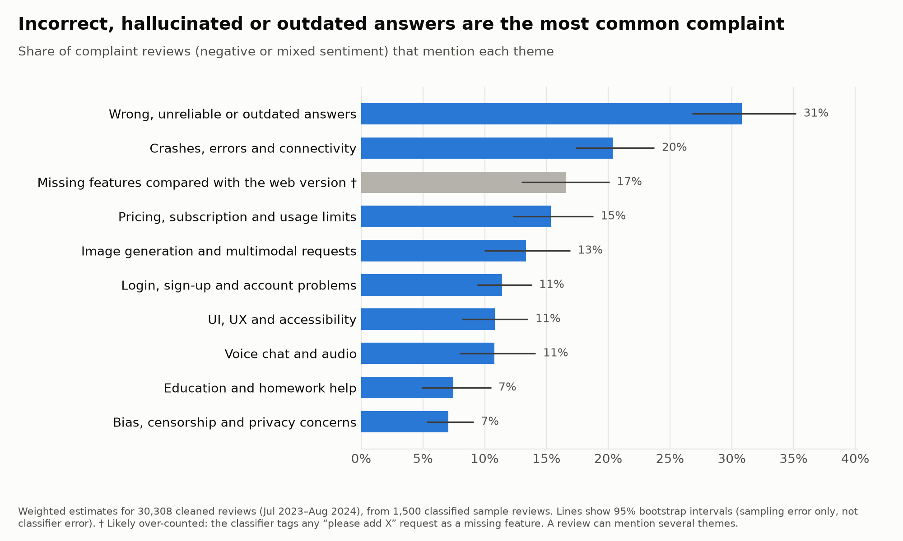
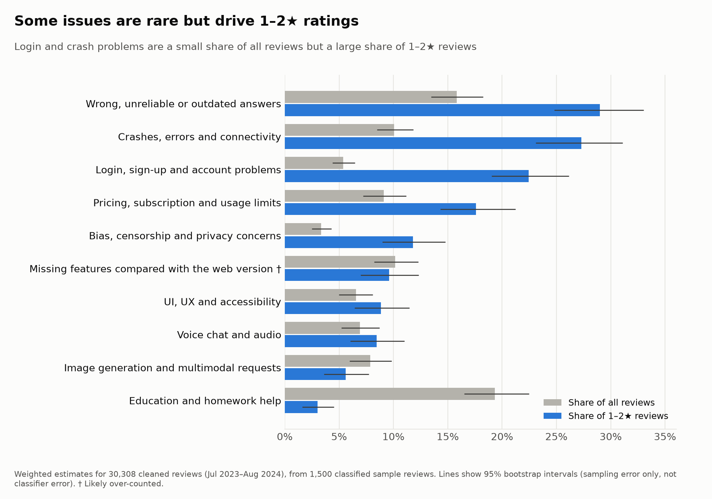
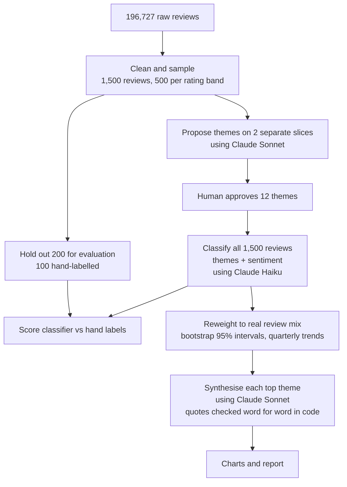

# User Feedback Insights Agent

An AI agent that turns thousands of app reviews into product insights: themes, sentiment, weighted shares with uncertainty ranges, and a per-theme synthesis backed by real user quotes. Built and evaluated on public ChatGPT Android app reviews.

## Key findings

ChatGPT Android app reviews, July 2023 to August 2024 (30,308 cleaned reviews, estimated from a stratified sample of 1,500).

- **Incorrect, hallucinated or outdated answers are the most common complaint:** 31% of negative and mixed reviews (95% interval 27–35%).
- **Login problems are rare overall but drive 1–2★ ratings:** 5% of all reviews, 22% of 1–2★ reviews. Crashes (10% → 27%) and bias/censorship (3% → 12%) follow the same pattern.
- **Study and learning help is the main positive use case:** 19% of all reviews, 3% of 1–2★.
- **No trend passed the significance check.** Pricing complaints rose from 13% to 21% of complaints between 2023Q4 and 2024Q2, but the intervals overlap, so it is a directional signal only.





Full per-theme synthesis, with sub-issues, quotes and opportunities: [insights/synthesis.md](insights/synthesis.md)

## Workflow



**Guardrails:** Every model output is validated in code (review IDs, theme IDs, sentiment values, quote text). Invalid JSON is retried once; a reply cut off by the token limit fails fast. All counts and percentages are computed in code, never by the model.

## How it works

| Step | Script | What it does | Done by |
|---|---|---|---|
| 1. Prepare | `prepare.py` | • Removes empty, duplicate, very short and non-English reviews (196,727 → 30,308)<br>• Draws 500 reviews per rating band (1–2★, 3★, 4–5★), 100 per quarter, fixed seed<br>• Saves band × quarter weights to scale results back to the real review mix | Python code (no AI) |
| 2. Propose themes | `propose_themes.py` | • Sets aside 200 eval reviews first<br>• Proposes 8–15 themes on two non-overlapping slices of 200 reviews<br>• 11 themes came out the same in both runs | Claude Sonnet |
| 3. Approve themes | `themes/approved_themes.json` | • I merged, folded and renamed themes into a final list of 12, each with definition, includes and excludes | Me |
| 4. Classify | `classify.py` | • Labels every review with one or more themes and a sentiment, in batches of 20<br>• Validates every ID, theme and sentiment in code | Claude Haiku |
| 5. Score | `score_classifier.py` | • Compares the classifier with 100 hand-labelled reviews: per-theme precision, recall, F1; sentiment accuracy | Python code (no AI) |
| 6. Weight | `insights.py` | • Reweights to the full cleaned set<br>• 95% intervals by bootstrap (1,000 resamples)<br>• Quarterly trends, flagged only if intervals don't overlap | Python code (no AI) |
| 7. Synthesise | `synthesize.py` | • Per theme: summary, sub-issues, 3 quotes, likely causes (as hypotheses), opportunity<br>• Quotes must appear word for word in the cited review; sub-issue counts computed in code | Claude Sonnet |
| 8. Chart | `make_charts.py` | • Complaint ranking and severity charts with intervals | Python code (no AI) |

## How it was evaluated

| Metric | Mean of 4 runs | Range |
|---|---:|---:|
| Theme micro F1 | 0.79 | 0.78–0.80 |
| Theme macro F1 | 0.77 | 0.75–0.78 |
| Sentiment accuracy | 81% | 79–83% |

F1 combines how often the model's theme tags are right and how many of my tags it found (1.0 = perfect agreement). Micro F1 pools all theme tags, so common themes count more; macro F1 averages the 12 themes equally.

- **Answer key:** 100 eval reviews hand-labelled by me, held out from theme proposal. The labels were then checked against the written theme definitions with AI assistance; 49 rows were corrected and every change is logged.
- **One round of prompt fixes only.** Two rules existed in my labelling but not in the prompt (praise alongside a complaint still counts as praise; sentiment rules). I added them once and stopped, to avoid tuning the prompt to the answer key.
- **Noise measured before claiming improvement.** Across 4 runs, only the praise fix made a real difference. Every other before/after change was within run-to-run variation.

## What I learned

- **Rules in my head are not rules in the prompt.** The biggest accuracy gain came from writing down labelling rules I had been applying without stating them.
- **One run can mislead.** A macro F1 "drop" after the fix turned out to be the lowest of four runs, not a real decline.
- **Validation in code catches what review would miss.** It rejected an invented theme ID (`chat_history_placeholder_remove`) and review IDs written in the wrong format, both of which would otherwise have silently corrupted results.
- **Sampling and weighting change the story.** 76% of raw reviews are 5★ praise. Equal samples per rating band surface complaints; reweighting restores the true proportions. Each sampled 4–5★ review stands for 38–67 real ones.
- **A labelling checkpoint pays off.** Pausing after 20 labels exposed that "missing features" was being used as a catch-all, before the answer key was finished.

## Limitations

- Reviews date from July 2023 to August 2024; some issues may have been fixed since.
- The answer key was partly AI-corrected, so it is not fully independent of the models being evaluated.
- Themes with fewer than 10 hand labels (Login, Images, Voice, Other, UI/UX) have unreliable per-theme scores.
- The classifier confuses "missing features" with "UI/UX", and tags "please add X" requests as missing features, so that theme is likely over-counted.
- Sub-issue counts are lower bounds; sub-issues cover 57–96% of complaint-theme reviews and 44% of education reviews (weighted).
- Intervals cover sampling error only, not classifier error.
- Likely causes are hypotheses from review text, not verified against product data.

## Run it

Requires Python 3.12 and an Anthropic API key.

1. Download [ChatGPT Users Reviews](https://www.kaggle.com/datasets/anandshaw2001/chatgpt-users-reviews) (CC0) and save it as `data/ChatGPT_Reviews.csv`.
2. Set up:

```
python -m venv venv
source venv/bin/activate
pip install -r requirements.txt
echo "ANTHROPIC_API_KEY=your-key" > .env
```

3. Run:

```
python prepare.py                           # clean and sample (no API calls)
python propose_themes.py                    # propose themes (2 Sonnet calls)
python classify.py --subset eval-labelled   # classify the 100 hand-labelled reviews
python score_classifier.py                  # score against hand labels
python classify.py --subset all             # classify all 1,500 reviews
python insights.py                          # weighted estimates and intervals
python synthesize.py                        # per-theme synthesis (7 Sonnet calls)
python make_charts.py                       # charts
```

## Repository

| Path | Contents |
|---|---|
| `sample/` | The 1,500-review sample and preparation summary |
| `themes/` | Proposed themes (2 runs), comparison and the approved list |
| `eval/` | Held-out eval IDs and the hand-labelled answer key |
| `outputs/` | Classifier labels, scores and disagreements |
| `insights/` | Weighted metrics, per-theme synthesis and charts |
| `BUILD_LOG.md` | Build notes in order, including what went wrong |

## Source

[ChatGPT Users Reviews](https://www.kaggle.com/datasets/anandshaw2001/chatgpt-users-reviews) on Kaggle, CC0 public domain. The full dataset is not committed; only the 1,500-review sample is.

Built with Claude Code as the coding assistant. I designed the pipeline and evaluation, approved the theme list, hand-labelled the answer key, and reviewed every change.
